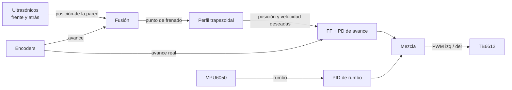

# Robot Roborregos

Robot autónomo con el que Pablo y su equipo compiten en el reto de robótica de **Roborregos**. El robot recorre una pista formada por celdas cuadradas de **30 × 30 cm** y debe resolver distintos retos dentro de ella. Para eso necesita moverse con precisión (avanzar exactamente una celda, girar 90°), ubicarse respecto a las paredes y reconocer colores u objetos.

Este repositorio contiene el código del robot y la documentación del proyecto.

---

## Contenido

1. [Estado del proyecto](#estado-del-proyecto)
2. [El robot](#el-robot)
3. [Componentes](#componentes)
4. [Alimentación y notas eléctricas](#alimentación-y-notas-eléctricas)
5. [Mapa de pines del ESP32](#mapa-de-pines-del-esp32)
6. [Estructura del repositorio](#estructura-del-repositorio)
7. [Prueba de avance recto](#prueba-de-avance-recto)
8. [Puesta en marcha y calibración](#puesta-en-marcha-y-calibración)
9. [Guía de ajuste (tuning)](#guía-de-ajuste-tuning)
10. [Física detrás del código](#física-detrás-del-código)
11. [Próximos pasos](#próximos-pasos)
12. [Datos por confirmar](#datos-por-confirmar)

---

## Estado del proyecto

| Módulo | Estado |
|---|---|
| Asignación de pines | Hecha (ver tabla) |
| Avance recto (motores + encoders + giroscopio + ultrasónicos) | Código listo, validado en simulación, **falta probar en el robot** |
| Giros de 90° | Pendiente |
| Centrado lateral con ultrasónicos izquierdo/derecho | Pendiente |
| Sensor de color TCS34725 | Pendiente |
| Cámara ESP32-CAM | Pendiente |
| Garra (servo) | Pendiente |

La electrónica todavía no está armada al 100%.

---

## El robot

- **Base circular de 20 cm de diámetro.**
- **Tracción diferencial**: dos motores laterales, uno por rueda. Al girar las ruedas en sentidos opuestos, el robot gira sobre su propio eje, lo que facilita moverse por la cuadrícula.
- **Rueda loca** (caster) atrás, solo como apoyo; toda la tracción la dan los dos motores.
- **Encoders** en ambos motores y **giroscopio** para que el movimiento sea lo más preciso posible.
- **Hasta 4 sensores ultrasónicos** (frente, atrás, izquierda, derecha) para ubicarse en la pista midiendo la distancia a las paredes.
- **Sensor de color** para identificar celdas especiales, **cámara** para reconocer objetos o marcas y **garra con servo** para manipular objetos.

**Por qué importa la precisión:** el robot mide 20 cm y la celda 30 cm, así que solo quedan **5 cm libres de cada lado**. Un error de rumbo de 1° desvía el robot 5.2 mm de lado por cada celda (300 mm × sin 1°). Después de unas cuantas celdas ya roza la pared. Por eso el código mantiene el rumbo con el giroscopio y usa las paredes para corregir la posición.

---

## Componentes

| Componente | Uso | Notas |
|---|---|---|
| ESP32-S (38 pines) | Cerebro del robot | Lógica a 3.3 V: **ningún pin tolera 5 V** |
| 2 × motor JGA25-371, 200 RPM, con encoder | Tracción | Motor de 12 V con encoder Hall de 11 pulsos por vuelta del motor |
| Driver TB6612FNG | Controla los 2 motores | VM máx. 13.5 V; 1.2 A continuos y 3.2 A pico por canal |
| LiPo 3S 11.1 V, 2100 mAh, 15C (Spard) | Batería | 12.6 V cargada; no descargar por debajo de ~9.9 V (3.3 V por celda) |
| LM2596 (step-down ajustable, 3 A) | 5 V para el ESP32, servo y ultrasónicos | **Ajustar a 5.0 V con multímetro antes de conectar nada** |
| Sensores ultrasónicos (~4, HC-SR04) | Distancia a las paredes | El HC-SR04 se alimenta con 5 V y su ECHO sale a 5 V (ver notas) |
| TCS34725 | Sensor de color | I2C, dirección 0x29 |
| ESP32-CAM | Visión | Se comunica por UART2 |
| Servo | Garra | 50 Hz, alimentado con 5 V del LM2596 |
| MPU6050 | Giroscopio y acelerómetro | I2C, dirección 0x68 |

---

## Alimentación y notas eléctricas

```
LiPo 3S (11.1 V) ──┬── TB6612 VM ──> motores
                   └── LM2596 (5.0 V) ──┬── ESP32 (pin 5V/VIN) ──> 3.3 V interno
                                        ├── servo de la garra
                                        └── ultrasónicos (VCC)
ESP32 3V3 ──> encoders, MPU6050, TCS34725, TB6612 VCC (lógica)
TODAS las tierras (GND) unidas
```

Precauciones importantes:

1. **Encoders a 3.3 V.** Los pines 34 a 39 del ESP32 no tienen resistencias pull-up y no toleran 5 V. La placa del encoder del JGA25 ya trae sus pull-ups, pero conectadas al VCC del encoder: si ese VCC es 5 V, la señal llega a 5 V al ESP32. Hay que alimentar el encoder con 3.3 V. Si a 3.3 V no da pulsos (prueba `e`), alimentarlo con 5 V y poner un divisor resistivo en cada canal.
2. **ECHO de los HC-SR04 a 3.3 V.** El pin ECHO entrega 5 V. Cada ECHO lleva un divisor: 1 kΩ en serie y 2 kΩ a GND (5 V × 2/3 ≈ 3.3 V). La versión HC-SR04P funciona a 3.3 V y no necesita divisor.
3. **TB6612 y atascos.** Un motor JGA25-371 trabado puede pedir más de 1.2 A, por encima de lo que el TB6612 aguanta en continuo. El código aborta el movimiento si el robot no avanza como debería (por ejemplo, si choca con una pared).
4. **Capacitor en la línea de 5 V** (por ejemplo 470 µF) cerca del servo: los picos de corriente del servo pueden reiniciar el ESP32.
5. **Batería.** Nunca bajar de 3.3 V por celda (9.9 V en total). Conviene un medidor o alarma de LiPo. A medida que se descarga (de 12.6 a ~10 V), el mismo PWM da menos velocidad; por eso el control de velocidad es en lazo cerrado con los encoders.

---

## Mapa de pines del ESP32

| Función | GPIO | Conector | Notas |
|---|---|---|---|
| PWMA (motor A, derecho) | 25 | A9 | PWM 20 kHz, 8 bits |
| AIN1 | 26 | A10 | |
| AIN2 | 27 | A11 | |
| PWMB (motor B, izquierdo) | 13 | A15 | PWM 20 kHz, 8 bits |
| BIN1 | 32 | A7 | |
| BIN2 | 33 | A8 | |
| STBY (TB6612) | 14 | A12 | LOW = motores apagados |
| Encoder A canal 1 (derecho) | 34 | A5 | Solo entrada, sin pull-up |
| Encoder A canal 2 | 35 | A6 | Solo entrada, sin pull-up |
| Encoder B canal 1 (izquierdo) | 36 (VP) | A3 | Solo entrada, sin pull-up |
| Encoder B canal 2 | 39 (VN) | A4 | Solo entrada, sin pull-up |
| I2C SDA | 21 | J6 | MPU6050 (0x68), TCS34725 (0x29), OLED (0x3C) |
| I2C SCL | 22 | J3 | |
| TRIG ultrasónicos (compartido) | 5 | J10 | Dispara todos a la vez |
| ECHO frente | 19 | J8 | Con divisor a 3.3 V |
| ECHO izquierda | 18 | J9 | Con divisor a 3.3 V |
| ECHO derecha | 23 | J2 | Con divisor a 3.3 V |
| **ECHO atrás** | **15** | — | **Propuesta nueva**, ver abajo |
| Servo garra | 4 | J13 | 50 Hz |
| CAM RX (recibe del TX de la cam) | 16 | J12 | UART2, 115200 |
| CAM TX (envía al RX de la cam) | 17 | J11 | UART2 |
| Botón BOOT (de la placa) | 0 | — | Botón de arranque de las pruebas |

**Sobre el ECHO trasero (GPIO 15).** Solo quedan libres pines de "strapping", que el ESP32 lee al arrancar:

- **GPIO 15** (elegido): si está en LOW al arrancar, solo se ocultan los mensajes de arranque del puerto serie. Es inofensivo.
- GPIO 2: en muchas placas tiene el LED azul, que carga la señal del divisor.
- GPIO 12: **evitar**. Si está en HIGH al arrancar, el ESP32 configura la flash a 1.8 V y no arranca.
- GPIO 0: es el botón BOOT; aquí se usa como botón de arranque.

---

## Estructura del repositorio

```
Robot-Roborregos/
├── README.md                     <- este archivo (contexto completo)
└── pruebas/
    └── avance_recto/
        ├── avance_recto.ino      <- vacío; permite abrir la carpeta en el IDE de Arduino
        └── avance_recto.cpp      <- código de la prueba de avance recto
```

---

## Prueba de avance recto

`pruebas/avance_recto/avance_recto.cpp` hace que el robot avance en línea recta una distancia exacta (por ejemplo, una celda) usando tres fuentes de información:

| Sensor | Qué aporta | Fortaleza | Debilidad |
|---|---|---|---|
| Encoders | Cuánto avanzó cada rueda | Rápidos (200 Hz), muy finos (~0.14 mm por cuenta) | Acumulan error si la rueda patina o el diámetro está mal |
| MPU6050 (giroscopio) | Hacia dónde apunta el robot | No le afecta que las ruedas patinen | Deriva lentamente (bias) |
| Ultrasónicos frente y atrás | Distancia absoluta a las paredes | No acumulan error | Lentos (20 Hz), ruidosos, solo sirven si hay pared |

### Cómo se combinan



1. **Perfil de velocidad trapezoidal.** El robot no arranca de golpe: acelera a 1000 mm/s² hasta 300 mm/s, viaja a velocidad constante y frena justo a tiempo. Así las llantas no derrapan y el frenado es predecible. El perfil se calcula en cada ciclo con la distancia restante (v ≤ √(2·a·d)), de modo que el punto de frenado puede moverse a medio camino.
2. **Control de avance** (cada 5 ms). Primero se calcula el PWM que en teoría da la velocidad deseada (*feedforward*: `KV_FF·v + KA_FF·a + KS_FF`). Encima, un PD corrige la diferencia entre la posición deseada y la que marcan los encoders.
3. **Control de rumbo.** Un PID mantiene el ángulo del giroscopio en el rumbo objetivo, acelerando una rueda y frenando la otra. La parte integral compensa que los dos motores nunca son idénticos.
4. **Fusión con ultrasónicos.** La pared no se mueve, así que *(lo que marcan los encoders) + (distancia a la pared)* debe ser constante. Cada lectura refina esa constante y con ella se ajusta el punto de frenado. Las lecturas raras (rebotes) se descartan. Si hay pared adelante y atrás, se combinan dando más peso a la más cercana. Cada lectura se asocia a la posición que tenía el robot cuando se disparó el sensor, así que su retraso no afecta.
5. **Modo celdas (`c1`).** Si hay una pared al alcance, el robot no solo avanza 30 cm: termina en el **centro** de la celda (centro del robot a 150, 450, 750… mm de la pared). Así corrige el error acumulado de movimientos anteriores, hasta 75 mm.
6. **Verificación.** Al terminar, el robot se queda quieto, mide las paredes 5 veces (mediana) y, si sigue fuera por más de 4 mm, hace una corrección pequeña.
7. **Seguridad.** El robot se detiene solo si las ruedas no siguen al perfil (está atorado o hay un sentido invertido), si el rumbo se desvía más de 20° o si se agota el tiempo. Nunca acerca su centro a menos de 125 mm de una pared. Cualquier tecla o el botón BOOT lo detienen.

Si no hay MPU6050 conectado, el rumbo se estima con la diferencia entre encoders (menos preciso, pero sirve para probar).

### Resultados en simulación

El código se compiló y se probó en una simulación física del robot. La simulación incluye motores con fricción e inercia, un motor 5% más débil que el otro, giroscopio con bias y ruido, y ultrasónicos con ruido, rebotes y lecturas perdidas. Resultados con `c1`:

- Llega a **±2 mm** del objetivo y termina con **menos de 0.4°** de error de rumbo, en ~1.5 s por celda.
- Con el robot 40 mm fuera del centro, termina centrado a 149.4 mm de la pared (objetivo: 150).
- Si el diámetro de llanta real es 66 mm en vez de 65, el error baja de 5.7 mm (solo encoders) a 2.2 mm (con la pared de enfrente).
- Sigue llegando aunque el `KV_FF` supuesto esté errado en ~25–30%, con la fricción real entre la mitad y 1.6 veces la supuesta y con 20% de lecturas ultrasónicas malas.
- Con un encoder, un motor o el giroscopio con el signo mal configurado, se detiene solo en 0.2–0.5 s.

Falta comprobarlo en el robot real: las ganancias seguramente necesitarán ajuste.

---

## Puesta en marcha y calibración

### Cargar el programa

1. Instalar el **IDE de Arduino 2.x**.
2. En *Herramientas → Placa → Gestor de placas*, instalar **"esp32" de Espressif Systems, versión 3.x**. Si no aparece, agregar en *Preferencias → URLs adicionales*: `https://espressif.github.io/arduino-esp32/package_esp32_index.json`.
3. Abrir `pruebas/avance_recto/avance_recto.ino` (el IDE abre también el `.cpp`).
4. Seleccionar la placa **"ESP32 Dev Module"** y el puerto, y subir el programa.
5. Abrir el **Monitor serie a 115200 baudios** con terminador **"Nueva línea"**.

No hace falta instalar librerías: los encoders usan el contador de pulsos por hardware del ESP32 (PCNT) y el MPU6050 se lee directo por I2C.

### Comandos

| Comando | Acción |
|---|---|
| Botón **BOOT** | Toma el rumbo actual como "recto" y avanza 1 celda (sin computadora) |
| `a300` | Avanza 300 mm (`a-150` = reversa 150 mm) |
| `c1`, `c2`… | Avanza 1, 2… celdas y se centra con las paredes |
| `m` | Prueba de motores y sentidos (**robot levantado**) |
| `e` | Prueba de encoders (girar las ruedas a mano) |
| `g` | Prueba del giroscopio |
| `u` | Lecturas de los 4 ultrasónicos |
| `k` | Caracterizar motores: sugiere `KV_FF` y `KS_FF` |
| `z` | Rumbo actual = 0 |
| `r` | Activa o desactiva el registro CSV del movimiento |
| `h` | Ayuda |

Cualquier tecla o el botón BOOT detienen el robot durante un movimiento.

### Orden de calibración (la primera vez)

Todas las constantes están al principio de `avance_recto.cpp`, en la sección **PARÁMETROS FÍSICOS**.

1. **Antes de conectar la batería**, medir la salida del LM2596 y ajustarla a 5.0 V.
2. **`m` con el robot levantado.** Cada rueda debe girar hacia adelante y su encoder contar positivo. El programa indica qué cambiar en `INVERTIR_MOTOR_*` e `INVERTIR_ENC_*`. **Esto es lo primero**: con un signo invertido el control se vuelve inestable.
3. **`e`**. Marcar la llanta y darle 10 vueltas exactas a mano. Deben salir ~1496 cuentas por vuelta (11 pulsos × 4 flancos × 34 de reducción). Si sale otro número, ajustar `REDUCCION`.
4. **Diámetro de rueda.** Medirlo con vernier en `DIAMETRO_RUEDA_MM`. Para afinarlo, con `a1000` sin paredes cerca, comparar lo que reporta *"Encoders: avanzó"* con una cinta métrica: `D_nuevo = D_actual × distancia_real / distancia_encoders`.
5. **`g`**. Girar el robot 90° a la izquierda: debe marcar ~+90. Si marca −90, poner `GIRO_SIGNO = -1`. Dejarlo quieto 1 minuto: el rumbo no debe moverse más de ~1°.
6. **`u`**. Comparar con una regla. Ajustar `US_OFFSET_*` (distancia del centro del robot a la cara de cada sensor).
7. **`k`** (con ~40 cm libres al frente o con el robot levantado). Copiar los `KV_FF` y `KS_FF` sugeridos y no pasar de la `VEL_CRUCERO` recomendada.
8. **`a300` sin paredes** para ver qué tan recto va (con una cinta pegada al piso como referencia). Después, **`c1` con paredes**.

---

## Guía de ajuste (tuning)

Activar el registro con `r`: después de cada movimiento se imprime un CSV (tiempo, posición deseada y real, velocidad, rumbo, PWM) que se puede graficar en una hoja de cálculo.

| Síntoma | Qué ajustar |
|---|---|
| Zigzaguea o "culebrea" | Bajar `KP_RUMBO` o subir `KD_RUMBO` |
| Se va de lado poco a poco | Subir `KI_RUMBO`; revisar que el MPU esté bien fijado y plano |
| Se pasa del objetivo y regresa | Bajar `KP_AVANCE`, subir `KD_AVANCE` o `KA_FF` |
| Se queda corto y no termina de llegar | Subir `KS_FF` |
| Las llantas derrapan al arrancar | Bajar `ACELERACION` |
| "ERROR: las ruedas no siguen al perfil" | Signos invertidos (prueba `m`), `VEL_CRUCERO` muy alta para la batería o `KV_FF` muy bajo |
| "ERROR: el rumbo se desvió demasiado" | `GIRO_SIGNO` al revés o una rueda trabada |
| Ignora la pared de enfrente | Revisar `u`; la pared debe estar a menos de `US_RANGO_FUSION_MM` (800 mm) |

---

## Física detrás del código

**Velocidad máxima.** A 200 RPM con rueda de 65 mm: v = (200/60) × π × 65 ≈ **680 mm/s** sin carga a 12 V. Con la batería a 11.1 V y con carga, en la práctica son ~550–600 mm/s. Por eso la velocidad de crucero es 300 mm/s: deja margen para que el control corrija.

**Resolución del encoder.** 11 pulsos × 4 flancos (cuadratura) × 34 (reducción) = 1496 cuentas por vuelta de rueda → π × 65 / 1496 ≈ **0.14 mm por cuenta**.

**Aceleración y tracción.** Las llantas derrapan si a > μ·g·(fracción del peso sobre las ruedas motrices). Con μ ≈ 0.7 y ~70% del peso sobre las ruedas, el límite es ~4.8 m/s². Se usa 1 m/s² (~0.1 g) con margen de sobra. Distancia de frenado desde 300 mm/s: d = v²/(2a) = 45 mm (56 mm con el margen de frenado del 80%).

**Feedforward.** En estado estable, un motor DC cumple V ≈ Kₑ·ω + R·i: el voltaje (PWM) necesario crece linealmente con la velocidad (`KV_FF`), más un mínimo para vencer la fricción (`KS_FF`). Para acelerar hace falta torque extra, proporcional a la aceleración (`KA_FF`). El PD solo corrige lo que el modelo no predice.

**Velocidad del sonido.** c = 331.3 + 0.606·T m/s (346.5 m/s a 25 °C). El eco recorre ida y vuelta: d = t·c/2. Un error de 5 °C en la temperatura supuesta da ~0.9% de error en la distancia (~3 mm a 30 cm).

**Ángulo con la pared.** El HC-SR04 tiene un cono de ±15° aproximadamente. Si el robot está muy chueco respecto a la pared, el sonido rebota hacia otro lado (reflexión especular) y no regresa. Por eso mantener el rumbo también ayuda a que los ultrasónicos funcionen.

**Giroscopio.** El rumbo es la integral de la velocidad angular: θ = ∫ω dt. Un bias sin corregir de 1 °/s acumularía 60° en un minuto. Por eso se calibra al arrancar (el robot debe estar quieto unos 2 s) y se sigue re-estimando cada vez que el robot está detenido, porque el bias del MPU6050 cambia con la temperatura.

---

## Próximos pasos

1. **Probar el avance recto en el robot real** y ajustar constantes (sección de calibración).
2. **Giros de 90° sobre su eje** con el giroscopio (mismo esquema: perfil trapezoidal en ángulo + PID).
3. **Centrado lateral** con los ultrasónicos izquierdo y derecho: mantenerse a 50 mm de las paredes laterales y corregir el ángulo respecto a ellas. El giroscopio solo mantiene el rumbo con el que arrancó; no sabe si el robot empezó chueco respecto a la pista.
4. Integrar el **sensor de color**, la **cámara** y la **garra**. Al agregar el servo, revisar que use un timer LEDC distinto al de los motores: el servo trabaja a 50 Hz y los motores a 20 kHz, y si compartieran timer uno le cambiaría la frecuencia al otro.
5. Navegación por la cuadrícula: mapa de celdas, paredes y retos.

---

## Datos por confirmar

Valores que el código supone y conviene medir o confirmar:

- [ ] Diámetro real de las llantas (se supuso **65 mm**).
- [ ] Distancia entre las dos ruedas (se supuso **170 mm**).
- [ ] Reducción exacta de los JGA25-371 de 200 RPM (se supuso **1:34**, verificar con la prueba `e`).
- [ ] Modelo de los ultrasónicos (HC-SR04 de 5 V o HC-SR04P de 3.3 V).
- [ ] Si se usará un 4.º ultrasónico atrás en el GPIO 15.
- [ ] Posición de cada sensor respecto al centro del robot (se supusieron **95 mm**).
- [ ] Grosor de las paredes de la pista y si todas las celdas tienen paredes en los bordes.
- [ ] Lista de retos específicos de la competencia.
